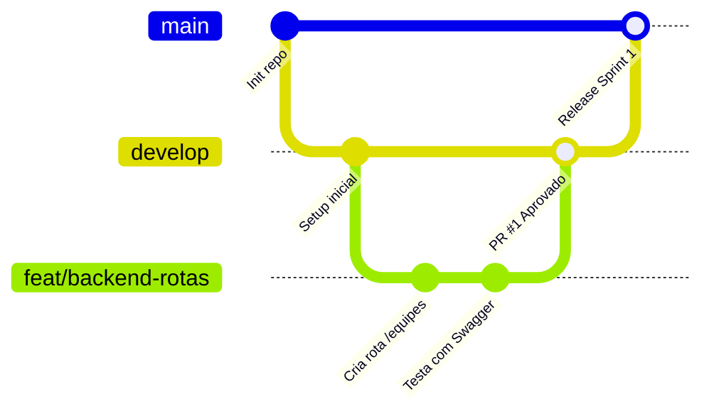

# Guia de Contribuição para os Alunos (Git & Boas Práticas)

Bem-vindo(a) ao time de desenvolvimento da Gincana Tecnológica JENPEX! Este guia foi feito para você aprender na prática como equipes de software profissionais trabalham no mundo real.

---

## 🧭 O Ciclo de Trabalho (Git Workflow)

Trabalharemos com o fluxo baseado em **Feature Branches**:



### Regras das Branches:
- `main`: Código de produção (estável, testado e pronto para o dia da Jenpex). Apenas o professor ou líder técnico pode fazer merge aqui.
- `develop`: Código de integração. Todos os alunos enviam seus Pull Requests para cá.
- `feat/<nome-da-tarefa>`: Sua branch pessoal de trabalho para uma funcionalidade nova.
- `fix/<nome-do-bug>`: Branch para corrigir algum problema encontrado nos testes.

---

## 🛠️ Passo a Passo do Aluno: Do Início ao Fim da Tarefa

### 1. Escolha a sua tarefa
Acesse a aba **Issues** ou o **Projects** (Kanban) no GitHub do projeto e atribua uma tarefa do seu Squad para você.

### 2. Atualize sua máquina antes de começar
Abra o terminal no repositório e execute:
```bash
git checkout develop
git pull origin develop
```

### 3. Crie a sua branch
Exemplo para criar uma branch do squad de frontend:
```bash
git checkout -b feat/telao-animacao-podio
```

### 4. Desenvolva e teste localmente
Faça suas alterações no código e teste antes de enviar.

### 5. Faça commits atômicos e claros
Evite commits com mensagens como `"atualizado"`, `"teste"` ou `"funciona"`. Use mensagens descritivas:
- `feat(backend): adiciona rota de calculo de ranking ordenado`
- `style(telao): melhora contraste das cores do primeiro colocado`
- `fix(admin): impede insercao de nota negativa para equipes`

Comandos:
```bash
git add .
git commit -m "feat(telao): implementa efeito sonoro ao mudar lider da gincana"
```

### 6. Envie sua branch para o GitHub
```bash
git push -u origin feat/telao-animacao-podio
```

### 7. Abra um Pull Request (PR)
1. Vá até o repositório no GitHub.
2. Clique no botão verde **Compare & pull request**.
3. **MUITO IMPORTANTE:** Certifique-se de que a branch base é `develop` (e não `main`).
4. Preencha o template do PR explicando o que você fez e marcando qual Issue ele resolve (ex: `Resolve #12`).
5. Marque um colega de squad para revisar o código e o professor como revisor final.

---

## 🔍 Como Fazer Code Review (Revisão de Código)

Quando um colega pedir para você revisar o PR dele:
1. Olhe a aba **Files changed** no GitHub.
2. Verifique se o código está legível e se não quebrou nada.
3. Seja gentil e construtivo nos comentários!
   - 👍 *"Adorei a forma como você simplificou essa função!"*
   - 💡 *"E se a gente adicionar uma mensagem de erro caso o MySQL caia?"*
4. Se estiver tudo certo, clique em **Review changes** -> **Approve**.
