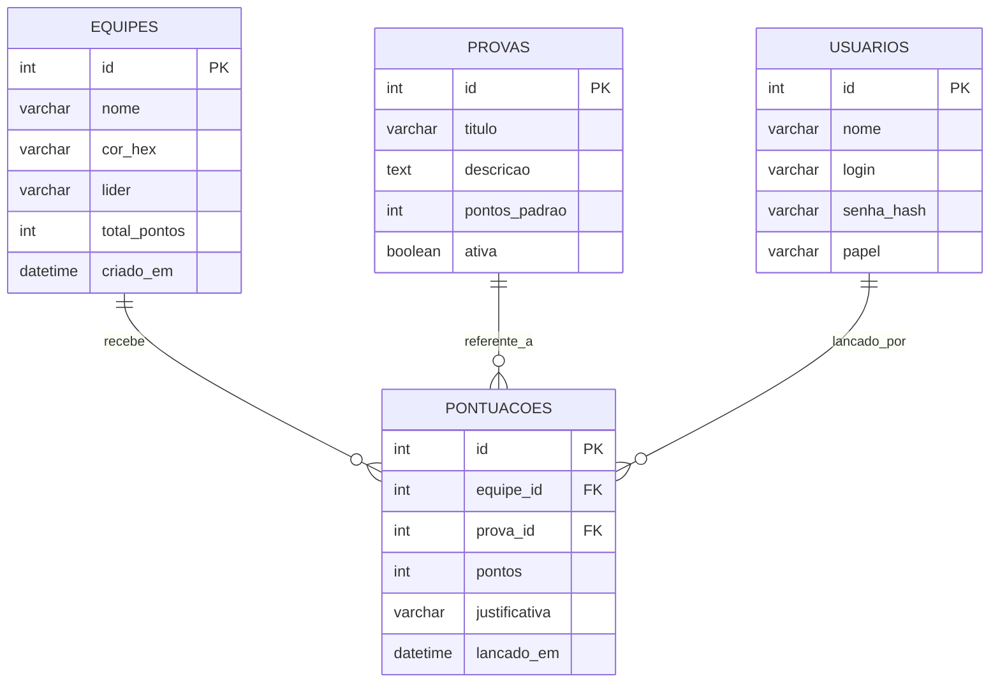

# 🏛️ Arquitetura do Sistema - Gincana Tecnológica JENPEX

Este documento descreve como os componentes do sistema se comunicam, como os dados fluem em tempo real e a modelagem do banco de dados MySQL.

---

## 📐 Visão Geral da Arquitetura

O sistema é baseado em uma arquitetura de microsserviços desacoplada:

```mermaid
flowchart TD
    subgraph Clientes ["Camada de Apresentação (Frontend Vue.js)"]
        Telao["🖥️ Telão Público\n(Visualização em Tempo Real)"]
        Admin["📱 Painel do Jurado / Admin\n(Lançamento de Notas)"]
    end

    subgraph Servidor ["Camada de Aplicação (Backend Python)"]
        FastAPI["⚡ API REST FastAPI\n(Validação, Regras de Negócio)"]
        WSManager["📡 WebSocket Connection Manager\n(Transmissão em Tempo Real)"]
    end

    subgraph Dados ["Camada de Persistência"]
        MySQL[("🗄️ Banco de Dados MySQL\n(Equipes, Provas, Pontuações)")]
    end

    Admin -->|1. POST /api/pontuacoes (HTTP JSON)| FastAPI
    FastAPI -->|2. Grava histórico e atualiza pontuação| MySQL
    FastAPI -->|3. Dispara ranking recalculado| WSManager
    WSManager -->|4. Broadcast imediato (WebSocket)| Telao
    Telao -.->|Conexão Inicial: GET /api/ranking| FastAPI
```

---

## ⚡ Fluxo em Tempo Real Passo a Passo

1. **Lançamento de Pontos**:
   - O jurado acessa o painel pelo celular ou notebook (`/admin`).
   - Seleciona a **Equipe**, a **Prova** e digita os **Pontos** (ex: +50 pontos).
   - O painel envia uma requisição `POST /api/pontuacoes`.

2. **Processamento no Backend**:
   - O FastAPI valida os dados com Pydantic.
   - Salva a pontuação na tabela `pontuacoes` do MySQL.
   - Recalcula a tabela geral de pontuações de todas as equipes, ordenando do maior para o menor.

3. **Disparo Instantâneo (Broadcast)**:
   - O `ConnectionManager` de WebSockets envia a lista atualizada para todas as telas conectadas no endpoint `/ws/ranking`.

4. **Atualização Visual no Telão**:
   - O Telão em Vue.js recebe a mensagem WebSocket sem recarregar a página.
   - Uma animação suave (CSS Transition) move as equipes que subiram ou desceram de posição.
   - Um alerta visual ou sonoro comemora a mudança de liderança!

---

## 🔌 Especificação dos Endpoints REST

| Método | Rota | Descrição | Quem consome? |
| :--- | :--- | :--- | :--- |
| `GET` | `/api/health` | Verifica se o servidor e o banco estão online | Squad DevOps / QA |
| `GET` | `/api/equipes` | Lista todas as equipes cadastradas | Admin e Telão |
| `POST` | `/api/equipes` | Cadastra uma nova equipe (nome, cor, logo) | Admin |
| `GET` | `/api/provas` | Lista todas as atividades/desafios da gincana | Admin |
| `POST` | `/api/provas` | Cadastra nova prova e pontuação máxima | Admin |
| `GET` | `/api/ranking` | Retorna o ranking consolidado (ordenado por pontos) | Telão e Admin |
| `POST` | `/api/pontuacoes` | Lança pontos para uma equipe em uma prova | Admin / Jurados |
| `GET` | `/api/pontuacoes/historico` | Lista os últimos lançamentos de pontos | Admin |
| `WS` | `/ws/ranking` | Canal WebSocket aberto para o telão | Telão |

---

## 🗄️ Modelo Relacional do Banco de Dados (MySQL)



---

## 🛡️ Estratégia de Resiliência para o Telão

Para que nada falhe durante a Jenpex:
1. **Reconexão Automática do WebSocket**: Se o Wi-Fi oscilar por 2 segundos, o cliente Vue tenta se reconectar automaticamente a cada 3 segundos.
2. **Fallback por Polling**: Se o WebSocket não conectar por problemas de proxy na rede do campus, o Telão faz um `GET /api/ranking` a cada 10 segundos como plano B.
3. **Persistência Completa**: Como tudo é salvo no MySQL com histórico de logs, se o servidor for reiniciado, nenhum ponto é perdido.
